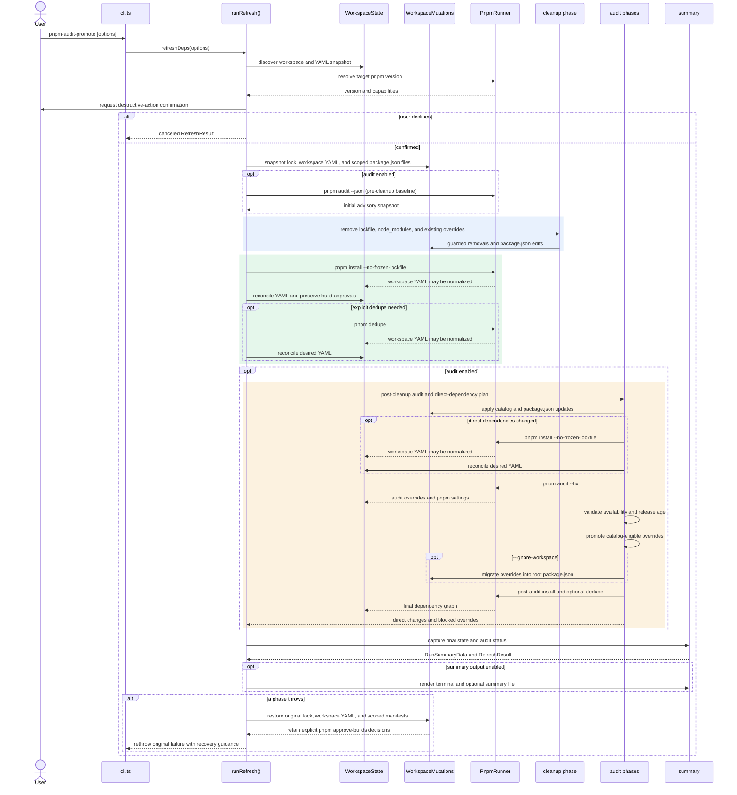

# Refresh Process Sequence

`runRefresh` owns the order of the refresh phases. Program-initiated file
changes use `WorkspaceMutations`; pnpm commands remain external process effects
and are reconciled with the desired workspace YAML snapshot after each call.

Failure recovery restores the lockfile, workspace YAML, and in-scope package
manifests. It retains build-script decisions recorded through the interactive
`pnpm approve-builds` flow. `node_modules` is not restored; the failure message
asks the user to run `pnpm install` before resuming work.
